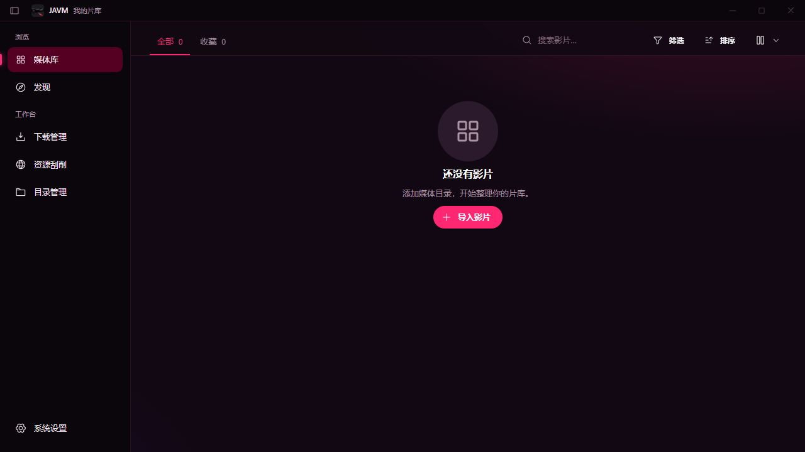
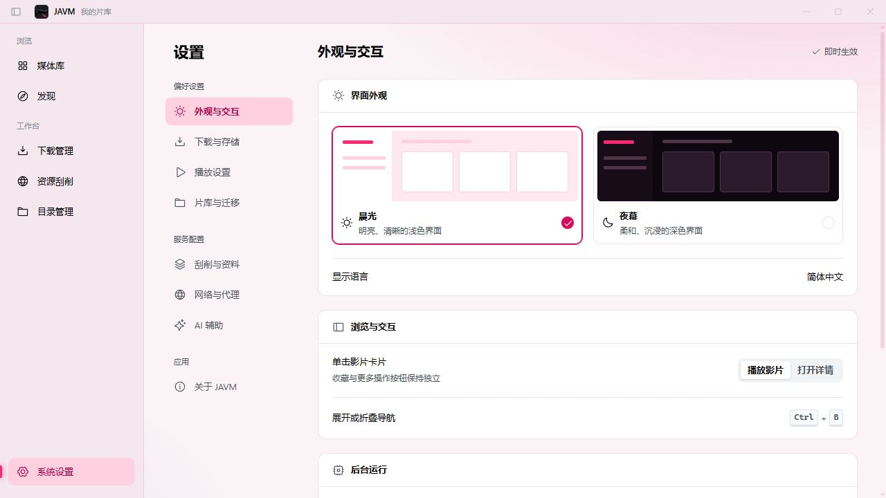

# JAVM

整理本地片库、管理影片资料，在一个桌面应用中完成搜索、下载与播放。

[](https://github.com/ddmoyu/javm/releases/latest) [](https://github.com/ddmoyu/javm/actions/workflows/release-alpha.yml) [](#下载与安装) [](LICENSE)

[下载正式版](https://github.com/ddmoyu/javm/releases/latest) · [预发布与历史版本](https://github.com/ddmoyu/javm/releases) · [更新日志](CHANGELOG.md) · [问题反馈](https://github.com/ddmoyu/javm/issues)

## 界面预览

以下为当前界面的浏览器预览截图，媒体库为空，不含影片、封面或用户数据。

<picture>
  <source media="(prefers-color-scheme: dark)" srcset="docs/images/library-dark.jpg">
  <source media="(prefers-color-scheme: light)" srcset="docs/images/library-light.jpg">
  
</picture>

<details>
<summary>查看浅色主题与外观设置</summary>



</details>

## 主要功能

- **片库整理**：后台扫描与增量更新、搜索和组合筛选、收藏、NFO 与封面管理，一部作品可关联多个视频。
- **资料与刮削**：发现与在线搜索、内置 MetaTube、批量刮削和资料编辑，也可先收藏资料，再下载或关联视频。
- **资源与下载**：视频资源查找、磁力搜索与外部下载器交接；MP4 / HLS 下载支持暂停续传、自动合并和失败重试。
- **播放与预览**：独立内置播放器、外部播放器、记住播放进度、视频抽帧、封面选择与图片预览。
- **备份与维护**：片库备份恢复、旧版数据迁移、缺失文件关联、重复视频检查和清理。
- **日常使用**：浅色与深色主题、托盘后台任务、正式版 / Beta 更新通道，以及异常反馈与历史记录。

AI 辅助默认关闭，可自行配置兼容接口，用于识别和资料翻译。功能细节见[功能开发状态](docs/FEATURE_STATUS.md)。

## 下载与安装

从[最新正式版](https://github.com/ddmoyu/javm/releases/latest)的下载表选择对应系统和架构。每个平台均提供安装包与便携包。

| 平台                      | 安装包               | 便携包                        |
| ------------------------- | -------------------- | ----------------------------- |
| Windows 10 / 11 · x64     | Setup `.exe`         | `.zip`，解压后运行 `JAVM.exe` |
| macOS 13+ · Apple Silicon | ARM64 `.dmg`         | ARM64 `.zip`，包含 `JAVM.app` |
| macOS 13+ · Intel         | x64 `.dmg`           | x64 `.zip`，包含 `JAVM.app`   |
| Ubuntu 24.04 · x64        | `.deb` / `.AppImage` | `.tar.gz`                     |

- Windows 需要 [WebView2 Runtime](https://developer.microsoft.com/microsoft-edge/webview2/)，运行包已包含媒体工具，无需安装 Node.js 或其他开发工具。
- macOS 包目前没有 Developer ID 签名或公证；Linux AppImage 与便携包需要相应系统库。系统依赖和验证范围见[跨平台说明](docs/CROSS_PLATFORM_STATUS.md)。
- 安装版与便携版均将个人数据保存在当前系统用户的数据目录；Windows 卸载会保留用户数据。

## 开始使用

1. 安装或完整解压对应版本，启动 JAVM。
2. 点击 **导入影片**，或进入 **目录管理 → 添加媒体目录**，选择本地目录并等待后台扫描。
3. 在媒体库中搜索、筛选、收藏和播放；在 **系统设置** 中调整主题、播放器、下载目录与网络偏好。

本地片库与本地视频播放可离线使用，在线资料、搜索、下载和 AI 服务需要网络。磁力链接可复制或交给系统关联的下载器。

**更新与旧库迁移**：在 **系统设置 → 关于 JAVM** 中检查更新，下载后确认重启安装。0.5.3 用户可从原更新入口升级，并按新版引导迁移片库。详见[自动更新](docs/decisions/0035-automatic-updates.md)与[旧库导入](docs/decisions/0018-legacy-database-import.md)。

1.0.5 / 1.0.6 的更新检查存在缺陷，请从[最新正式版](https://github.com/ddmoyu/javm/releases/latest)手动下载对应安装包覆盖安装，或完整解压新版便携包；无需卸载或删除个人数据。1.0.7 已修复后续更新检查。

## 参与开发

界面使用 React、TypeScript、Mantine 和 Vite+，桌面宿主使用官方 Neutralinojs；SQLite 与后台媒体服务使用 C++20。

<details>
<summary>本地预览与开发文档</summary>

准备仓库 [.node-version](.node-version) 指定的 Node.js 和 [package.json](package.json) 中的 pnpm 版本：

```powershell
pnpm install --frozen-lockfile
pnpm dev
```

浏览器预览地址为 `http://127.0.0.1:5173`；本机扫描、数据库、下载和桌面窗口能力需要桌面环境。

- [开发与构建](docs/DEVELOPMENT.md)：环境、命令、原生构建与安全截图。
- [GitHub Actions](docs/GITHUB_ACTIONS.md)：手动检查、组件复用与跨平台发布。
- [架构与决策](docs/REFACTOR_PLAN.md)：项目范围及后续 ADR。
- [工程约定](AGENTS.md)：分支、验证和协作规则。

开发、测试和截图只使用安全的虚构数据或空内容，不加载 NSFW 内容或真实用户片库。

</details>

采用 [MIT 许可证](LICENSE)。第三方组件的许可与来源随 Release 提供。
