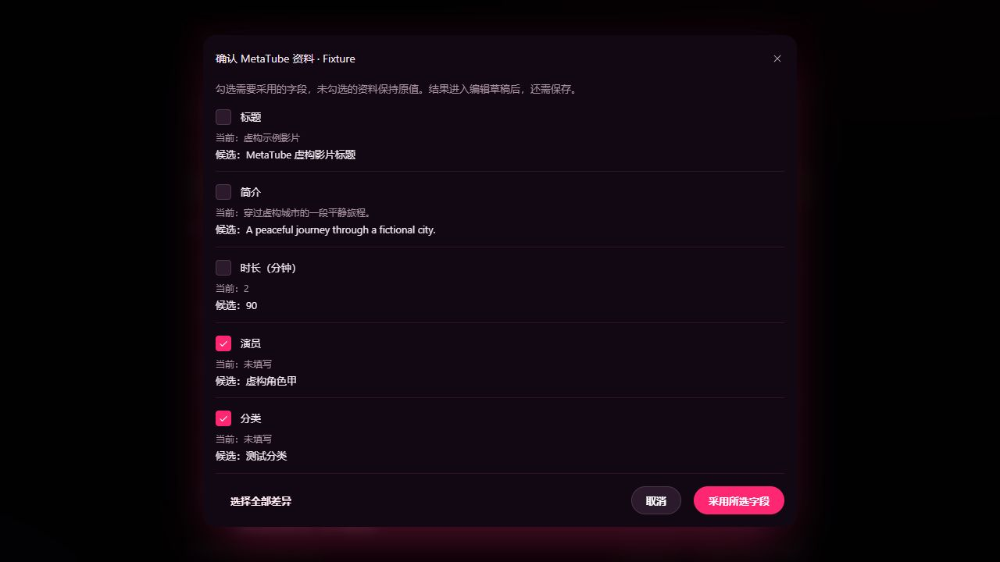
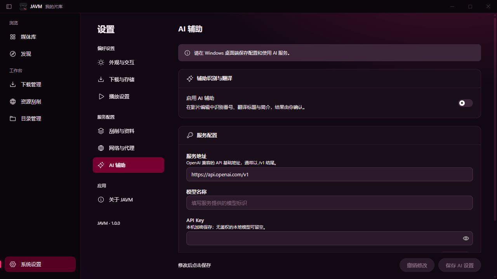
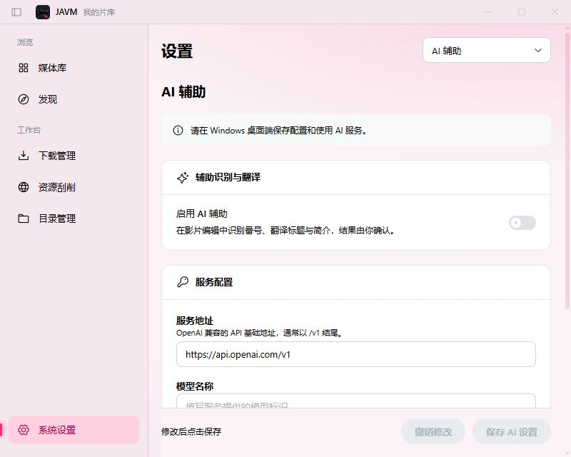

# MetaTube 与 AI 资料辅助验证

日期：2026-10-09。Windows、仓库锁定的 Neutralino 6.10.0／WebView2、React／Mantine；功能范围见 [ADR 0012](../decisions/0012-metatube-ai.md)。

后续已按用户要求改为随运行包内置 MetaTube，移除运行时安装、更新和路径选择流程。当前实现、测试命令和交付包见 [内置 MetaTube 验证](2026-10-09-bundled-metatube.md)；下文保留初始版本的历史验证结果。

## 检查与构建

- `pnpm check` 通过：247 个文件格式正确，194 个文件无 lint／类型错误或警告。
- `pnpm test`：161 通过，71 项需显式启用的集成测试跳过；跳过不计作通过。
- `pnpm build` 通过；仍存在较大 chunk 和依赖 `use no memo` 指令的已知构建警告。前端产物位于 `dist/frontend`，本轮未重新生成发布 EXE。

## 原生数据库与进程

- `pnpm native:build` 通过。`library.updateMetadata` 经官方 Extension 写入 SQLite，schema 保持 v4。
- 显式启用 `JAVM_MEDIA_INTEGRATION=1` 后，`metadata-native.integration.test.ts`、`library-query-native.integration.test.ts`、`nfo-native.integration.test.ts` 合计 **34/34** 通过；另运行 `media-native.integration.test.ts` **14/14** 通过。
- 合成影片验证：选择字段保存、未选择字段和路径保留、重复番号／未知字段拒绝、旧快照覆盖拒绝并完整回滚；重扫保留标题、简介、系列、演员顺序、时长／分辨率和显式清空的厂商／分类；原始 NFO 快照保留，重启扩展仍可按确认系列查询。所有数据库均为新建测试目录，未使用真实旧库。
- 显式启用 `JAVM_DOWNLOAD_INTEGRATION=1` 后，`download-engine.integration.test.ts` **14/14** 通过。覆盖 HTTP/HLS 下载与合并、长私有参数、宿主退出清理，并新增子进程代理覆盖时保留 `SystemRoot` 的验证。

## 隔离桌面服务

命令：`$env:JAVM_METATUBE_INSTALL='1'; pnpm test:metadata`。测试脚本创建独立 application ID、官方 storage 和应用数据目录，禁用媒体数据库扩展；仅用虚构影片信息和测试密钥。默认 `pnpm test:metadata` 运行前六项，不下载外部工具。

| 验证项                                                           | 结果 |
| ---------------------------------------------------------------- | ---- |
| AI 配置经 DPAPI 加密保存、新实例读取，存储中无明文密钥和模型     | 通过 |
| 无 CORS 的本机模拟 OpenAI 接口，经实际 curl 完成连接、识别、翻译 | 通过 |
| 错误密钥明确报错，不覆盖已保存的配置                             | 通过 |
| 取消慢请求，原生 curl 进程清理                                   | 通过 |
| 响应大小上限、本机请求绕过错误代理                               | 通过 |
| 已有 MetaTube 服务的私有端点鉴权、搜索、详情映射、断开           | 通过 |
| 官方 Windows amd64 ZIP 下载、SHA256 校验、安装                   | 通过 |
| 错误 SHA256 拒绝安装，保留原安装记录和可执行文件                 | 通过 |
| 真实 MetaTube 回环启动、来源健康检查、重启、停止和自有进程清理   | 通过 |

集成安装固定使用官方 `v1.4.0` 的 `metatube-server-windows-amd64.zip`（16,909,929 字节），SHA256 为 `2c08b0cec781030504c4cd70ececd3618dbf18847ed488ab5e12783dd1d267e6`。发行解析已覆盖官方仓库 URL、版本、架构和摘要校验；本轮也实际获取过官方 latest 信息。为避免共享出口的 GitHub 匿名配额干扰后续回归，安装集成测试固定该已验证包，生产代码仍查询官方 latest。遇到 HTTP 403／限流会显示失败，不当作安装成功。

最终桌面记录：`.tmp/metadata-desktop-21DuPq/result.json`，**9/9 通过**，无未处理异常。主动停止不会误报意外退出；重启后再次健康检查成功。

## 界面验证

使用 `pnpm exec vp dev --config tests/fixtures/metadata-ui/vite.config.ts` 打开 `http://127.0.0.1:5188/`。真实组件与应用服务连接隔离的模拟传输和内存片库；页面明确标注“交互测试 · 虚构服务”。

- AI 设置测试成功后仍显示未保存；保存后可从影片编辑识别番号、翻译标题与简介。候选首先进入确认窗口，已有字段默认未勾选，采用并保存后片名／番号刷新、写入次数增加。
- MetaTube 查询结果可进入逐字段预览；默认补齐空番号、演员、分类，不覆盖已有标题／时长。确认保存后重新打开可见已采用字段。
- 检查 1280×720 深色和 800×640 浅色布局；慢请求有取消反馈，运行中配置锁定、停止后恢复可编辑。
- 生产构建的 AI／MetaTube 设置入口也已检查：浏览器模式明确提示需要桌面端，保存／安装／连接按钮不可用；窄窗口使用设置分类下拉导航。已有服务模拟连接失败后可重试恢复，主动停止不再显示异常退出提示。生产页面控制台无错误或警告。
- 桌面验证确认实际 API、进程、加密存储与安装行为；界面视觉证据来自浏览器，不能视为 WebView2 原生窗口视觉验收。

## 验证边界

没有使用真实 AI 供应商账号或密钥，因此不宣称真实模型质量、付费额度或所有兼容服务均已验收。没有请求真实影片资料来源的外网搜索，不宣称各来源站点实时可用。其他站点资源搜索、批量刮削、图片／NFO 写出和多 AI 供应商轮换不在本轮实现内。本轮不发布或部署桌面安装包。
