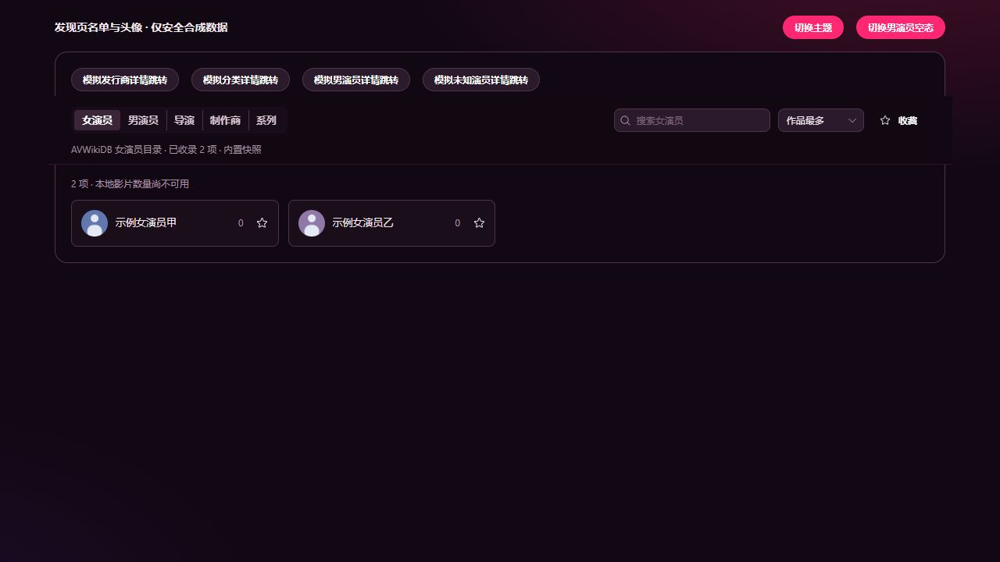
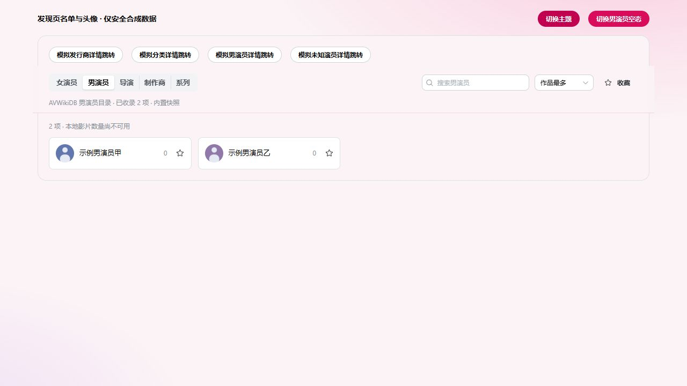

# AVWikiDB 离线名单与头像缓存验证

- 日期：2026-10-10
- 范围：五类 CSV 接入发现页，男女演员名单采集，AVWikiDB 头像链接、GFriends 兜底镜像与 AppData 缓存。
- 开发界面、测试和截图均使用安全虚构数据与本地占位图片，不使用真实成人作品、头像或用户数据库。

## 数据结果

| CSV    | 来源 ID 数 | 不同名称数 | 读取页数 |
| ------ | ---------: | ---------: | -------: |
| 女演员 |     44,731 |     44,489 |      448 |
| 男演员 |        379 |        379 |        4 |
| 导演   |      5,903 |      5,901 |       60 |
| 制作商 |      5,450 |      5,428 |       55 |
| 系列   |     49,388 |     49,251 |      494 |

合计 105,851 个来源 ID。男演员目录声明 386 条，排除 7 条 `/histrion/null/` 无编号记录。系列 49,389 个分页原始条目中有一个重复 ID，去重后为 49,388 条，站点分页声明总数存在缓存差异；没有补造缺失实体。

五份 CSV 合计 11,814,076 字节；头像链接索引 882,399 字节，女演员 13,807 个链接、男演员零个。链接可用性和真实图片内容未通过下载验证。随包内容仅为 CSV 与链接元数据，不包含已下载头像或完整 GFriends 图库。

全部 CSV 独立通过 UTF-8 BOM、字段结构、唯一 ID、原文与来源 URL 往返、分页连续和 SHA-256 校验。导演、制作商、系列 CSV 的字节未改动。中文译名与别名仍为空，翻译状态为 `pending`；应用支持读取后续校对的中文显示名。

## 实现验证

- 16 个相关前端及新测试文件的定向类型、lint 检查通过。
- 本次新增的两个测试文件、九个用例通过，没有运行既有完整测试集。
- 覆盖 CSV 转义和前缀编号、旧来源缓存隔离、中文标签保留、主列表与无编号异常解析、新头像链接持久化、主来源优先与镜像兜底、头像图片全局四个并发上限和取消。
- mock Neutralino 文件系统和下载进程，验证第二次创建缓存适配器时，头像及索引均未再次下载，缓存位于 AppData，镜像失败后尝试原始地址，没有遗留下载临时文件。
- 开发模式的真实头像适配器拒绝下载和缓存 I/O。
- `pnpm build` 成功，产物包含五个 CSV、`portraits.json` 和目录 Worker。构建仍有较大 chunk 及 React compiler 指令提示，不影响成功结果。
- 使用 Node Worker 读取生产构建的目录 Worker，网络限定为读取已打包本地资产。五类显示名计数与上表一致，另保留影片详情的旧发行商与分类维度；初始缓存约 1.33 百万字符。读取、解析、排序在该验证环境约 471 ms，属于后台 Worker 的耗时，不作为桌面启动速度承诺。
- 同一生产 Worker 成功解析已经取得的 GFriends 文件树，并返回主来源和镜像候选链接；没有请求这些图片。

## 安全界面验证

安全预览使用虚构男女演员、导演、制作商和系列。五类切换均显示对应名单及 AVWikiDB 来源状态。男女演员分别显示两张本地占位图片，分别模拟主来源成功与 GFriends 镜像成功；图片已加载且页面没有远程图片 URL。深色与浅色主题均保存截图。

## 范围与限制

头像缓存目录为 `%LOCALAPPDATA%/JAVM/cache/portraits`。图片最多 1,000 张、128 MiB，单张 2 MiB；备用索引单独最多 16 MiB。已成功缓存的主来源或兜底头像在后续启动直接复用。索引仅缺失或校验失败时重新下载，本次没有定期强制刷新索引。

jsDelivr 镜像依据 [GFriends 官方 README](https://raw.githubusercontent.com/gfriends/gfriends/master/README.md)。本机匿名元数据请求确认镜像及 GitHub 原始索引返回成功；没有验证真实图片下载，也没有验证中国大陆不同运营商的可达性。所有来源失效时保留内置名单和占位头像，不承诺规避站点访问限制。

本次没有启动生产桌面、访问真实用户数据库、下载或展示真实头像、重新构建原生 C++、制作安装包或发布版本。前端生产构建成功不等同于以上操作已验证。
