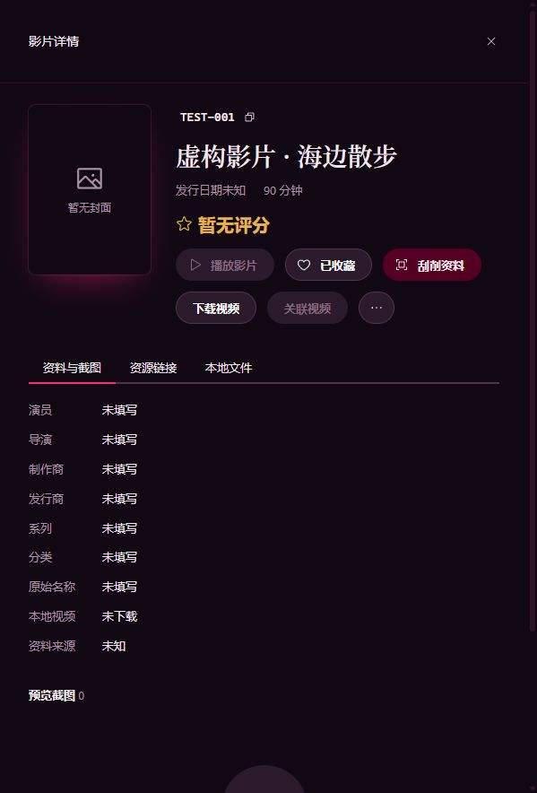

# 1.0 资料优先片库验证

2026-10-10。实现说明见 [ADR 0021](../decisions/0021-metadata-first-library.md)。所有数据库、视频和资料均为隔离合成数据；没有打开真实用户旧库。

## 已执行

- `pnpm native:build`：MSVC Debug 构建成功，包含新片库、扫描、NFO 写入及迁移器。
- `pnpm typecheck`：最终 281 个文件无类型错误。
- 对本次 TypeScript 修改执行指定文件的 `vp fmt`。
- 仅运行本次新增的三个测试文件，最终 **14/14 通过**：

```powershell
$env:JAVM_MEDIA_INTEGRATION='1'
pnpm test tests/metadata-library-native.integration.test.ts tests/legacy-1.0-native.integration.test.ts tests/metadata-first-scraping.test.ts --no-file-parallelism
```

| 用例组                | 覆盖                                                                                                                                                                                                         |
| --------------------- | ------------------------------------------------------------------------------------------------------------------------------------------------------------------------------------------------------------ |
| 原生资料闭环，5 项    | 无视频收藏写入 NFO；重复收藏；后补两个视频并归并；错误作品拒绝关联；删除视频保留资料；独立 NFO 重扫；缺失资源状态；移除目录与作品；外部 NFO 修改；人工番号与零时长；外部 NFO 评分/时长更新；路径挂载祖先去重 |
| 0.5.3 迁移，5 项      | 使用实际 `v0.5.3` 空 schema；作品/资源/关系转换；离线状态；BLOB 归档；双库备份；未知版本拒绝；中途失败回滚；新版资料优先；旧关联缺失拒绝；临时开发库字节保持不变                                             |
| TypeScript 调度，4 项 | 候选直接收藏刮削；下载携带作品身份及交接幂等；排队去重；MetaTube 取消时停止未确认错误透传                                                                                                                    |

首次并行验证曾出现原生进程/测试超时，另有新夹具的规范番号键大小写错误；已修正夹具、为跨进程多步骤用例设置合理整体超时并串行复核。产品内探测超时没有放宽。原有测试夹具已适配新表结构，临时 schema 升级用例已去除，本轮没有执行那些既有测试或完整回归。

## 界面验证

使用 `tests/fixtures/scraping-ui` 中正式 FilmDetail、NewDownloadModal、Scraper 和应用级任务服务，模拟下载、资料接口及写入。核对：

- 搜索结果“收藏并保存资料”进入队列并完成，任务显示“仅保存作品资料”。
- 未下载详情不能播放，只列实际 NFO；收藏可切换，隐藏未知视频大小和分辨率。
- 从详情发起下载展示作品关联，模拟下载完成后交接刮削。
- 最后检查正式详情布局，浏览器模式的本地文件选择按预期不可用。



## 未执行

没有进行真实 MetaTube 资料站点联网验收、完整 Neutralino 桌面端下载与托盘运行验收、生产前端构建或发布打包。浏览器夹具不代表真实外部接口可用。原生验证使用实际 Extension、SQLite、MediaInfo 和 NFO 文件，数据保留于 `.tmp/metadata-library-*` 与 `.tmp/legacy-1.0-*`。
