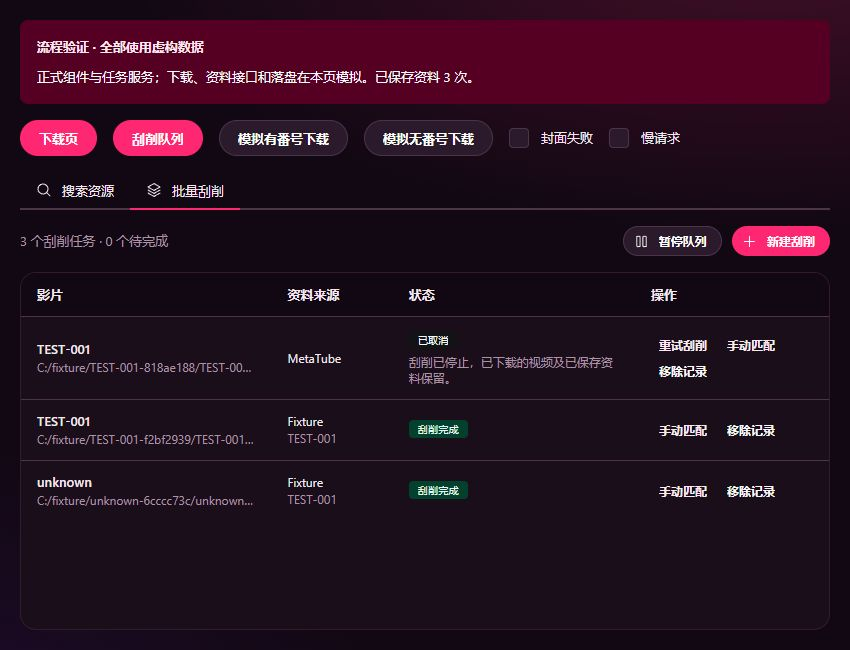

# MetaTube 基础刮削验证

日期：2026-10-10。实现范围见 [ADR 0020](../decisions/0020-metatube-scraping.md)。全部数据使用虚构资料、FFmpeg 生成的纯色视频、临时 SQLite 数据库及图片，没有读取或修改真实用户片库。

## 已执行

- `pnpm native:build`：MSVC Debug 构建成功，生成新的媒体扩展。
- `pnpm typecheck`：273 个文件无类型错误。
- 对本次修改的刮削、下载、MetaTube 服务及界面和新增测试执行定向 `vp lint`：无诊断。
- `pnpm build`：正式前端构建成功；现有播放相关大 chunk 和 React compiler 的 `use no memo` 打包提示仍存在。
- `$env:JAVM_MEDIA_INTEGRATION='1'; pnpm exec vp test run tests/scraping.test.ts tests/scraping-native.integration.test.ts`：本次新增的 18 个用例通过。没有运行完整测试或既有回归测试。
- 用 PowerShell/.NET XML 读取器独立解析实际生成的两个 NFO：均为有效 `movie` 文档，已有标题及外部最新标题正确保留。

## 关键证据

| 范围         | 实际验证                                                                                                                                                             |
| ------------ | -------------------------------------------------------------------------------------------------------------------------------------------------------------------- |
| 下载交接     | 成功后仅建一个刮削任务；来源失败不回退下载；重试不重复调用下载引擎；恢复遗漏交接，历史下载不自动处理                                                                 |
| 任务调度     | 单并发、取消阻止迟到提交、退出等待保存、在途状态恢复为中断、进程停止未确认时冻结调度并先清理再重试                                                                   |
| 匹配与请求   | 普通番号/FC2 规范化、多番号拒绝自动猜测、详情身份核对、人工候选继续、多 provider 分别请求、前台取消不影响后台                                                        |
| 真实原生扩展 | 官方 Extension 事件信封测试宿主，实际视频探测、单文件入库、SQLite 更新、NFO 和 PNG 落盘                                                                              |
| 文件保护     | NFO XML 转义、未知节点/注释/演员子节点保留、原始备份、人工清空与简介保护、外部 NFO 修改拒绝覆盖、错误图片部分成功、错误番号不改文件                                  |
| 持久化       | 合成 schema 1 下载库无损升级及可读备份，任务 revision 冲突拒绝，扩展重启后读回任务与下载                                                                             |
| 界面         | 浏览器使用正式 Downloads/Scraper/BatchScraper 和真实 TS 服务，模拟下载/接口/落盘；走通自动完成、下载菜单跳到待确认队列、填番号继续、手动搜索采用、封面失败重试及取消 |

浏览器验证夹具为 `tests/fixtures/scraping-ui`。开发期间其他文件修改触发过 HMR 和夹具重复 createRoot 提示；最终使用 `.tmp/scraping-ui-dist` 固定构建完成交互核对。没有把模拟服务当作真实 MetaTube 来源验收。

## 尚未验证

本次没有执行真实外部资料站点端到端刮削、完整 Neutralino 桌面下载链路或关闭到托盘连续运行验收，也没有发布运行包。MetaTube 的实际站点可用性仍取决于来源、代理和站点状态。文件与 SQLite 跨介质原子性、自动恢复正在保存时的异常断电不作保证；保留 NFO 备份，重试重新读取。

原生验证数据保留在 `.tmp/scraping-native-*`；使用独立 `downloads.sqlite3` 与 `javm.db`，不混入真实用户数据。
