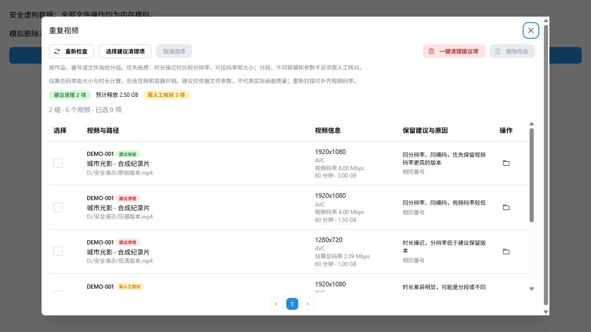
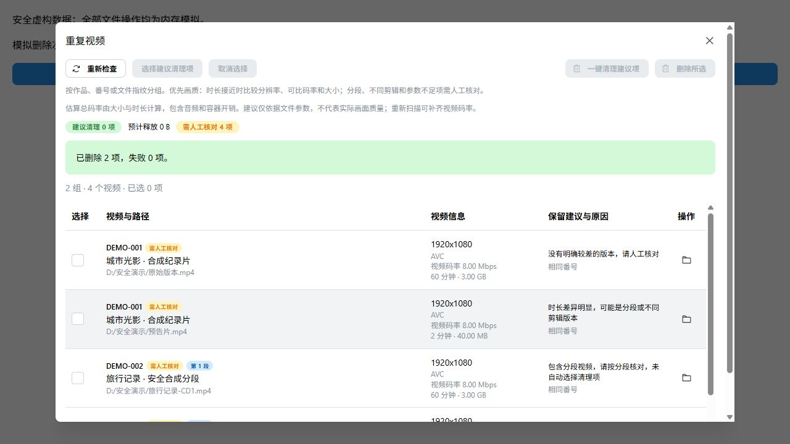

# 重复视频画质建议与清理

本轮按用户确认的“优先画质”优化现有重复清理。版本同步至 1.0.9，未发布。工作区已有的国际化与隐私功能修改未纳入本次提交。

## 行为

- 同一作品、番号或快速指纹关联的多个视频进入候选，显示分辨率、编码、视频码率、时长和大小，以及具体保留或清理理由。
- 实测视频码率来自 MediaInfo；旧记录缺少该值时明确显示估算总码率。下一次目录扫描补探测一次，格式不支持时保存已探测状态。
- 分段、不同剪辑、未知参数、不同编码或细微码率差异不自动纳入清理；选择计算与原生删除校验禁止不同分段互相替代。
- “一键清理建议项”选择全部建议项并进入确认，显示预计释放空间。取消不删除；确认后沿用逐文件身份和保留副本校验，保留作品资料。

## 验证

- `pnpm native:build`：MSVC Debug 构建通过。
- 本次涉及的 9 个 TypeScript 文件定向 Vite+ 检查通过，未运行全项目检查或前端生产构建。原生程序 `--version` 确认为 1.0.9。
- 提交前对暂存版本的重复清理弹窗及其依赖执行隔离 TypeScript 检查，通过；确认不依赖另行开发的国际化模块。
- 仅运行本轮新增的 `tests/duplicate-quality.test.ts` 与 `tests/duplicate-quality-native.integration.test.ts`，16/16 通过。覆盖实际码率优先、估算口径、分辨率、不同剪辑、分段、编码差异、快速指纹冲突、缺失参数、跨页选择与保留副本、数据库增量补表、隔离文件删除以及补探测后的缓存复用。
- 原生验证使用 `.tmp/duplicate-quality-*` 新建的数据库、文本文件与 FFmpeg 生成的安全测试图案视频；没有访问用户媒体或数据库。
- 浏览器验证运行正式组件、服务和真实 Worker，使用内存数据与模拟文件接口。已核对中文浅色、英文深色布局、建议选择、确认、取消及清理完成后的重新分组；取消时模拟删除次数为 0，确认后仅处理 2 个建议项，预告片与两个分段保留。英文布局验证依赖工作区另行开发的国际化修改。

未运行既有测试、完整回归、正式桌面 WebView2 或真实 NAS 验证。参数建议不等同于视频画面质量检测，快速指纹不等同于完整内容哈希。
