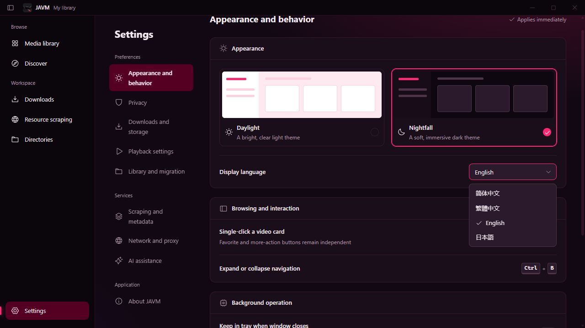

# 2026-10-15 界面多语言验证

范围：简体中文、繁體中文、English、日本語；入口为「设置 → 外观与交互 → 显示语言」。

## 代码与定向验证

- `pnpm typecheck`：通过；570 个文件无类型错误。
- `pnpm exec vp test run ../tests/i18n.test.ts`：仅运行本轮新增的 7 项用例，全部通过。
  覆盖三份词典键与参数一致性、插值保留原始标题和路径、已有动态状态消息显示、
  选项业务值不变、语言订阅、旧偏好重载和跨窗口重读、保存失败回滚。
- 对本轮修改文件执行格式化及定向 lint，无错误。已处理本轮新增的翻译参数类型和
  Hook 依赖警告；原有语义标签、effect 和方法绑定警告未扩大修复。
- 静态检查未发现未包裹的中文 JSX 文本、中文字面量属性或缺失的直接翻译键。
  此检查不等同于所有业务状态、原生错误消息和第三方内容的完整覆盖。
- `git diff --check`：通过。

## 浏览器验证

使用 `pnpm dev --port 5174` 的隔离浏览器预览，只打开空媒体库、设置和安全搜索文本，
未接入用户数据库、目录、真实内容源或外部下载。

- 四种语言选项均能选择；导航、标题、设置项、控件提示与 `document.lang` 同步更新。
- 英文与日文设置页在 1280 × 720 视口下检查布局；长导航标签能换行，未见遮挡。
- 英文刷新后仍为英文，重新打开窗口读取繁体偏好。
- 两个浏览器窗口同时打开，繁体切换英文后另一窗口立即更新；原搜索输入
  `安全示例 123`、输入框节点及页面状态保持不变。
- 新开窗口验证期间未记录浏览器控制台错误。先前补充错误边界订阅时发现的导出遗漏已修复。
- 验证结束恢复预览为简体中文，关闭本轮创建的浏览器页及开发服务器。

## 未执行范围

未运行全量测试、前端发布构建、原生构建、桌面安装包或托盘/系统文件对话框运行验收。
播放器与图片预览接入本地语言包已做静态和类型检查，未播放媒体进行控件运行验收。
未提交、推送或发布；版本沿用当前未发布工作区的 1.0.9。
